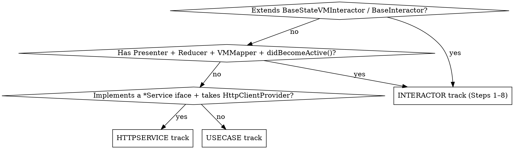
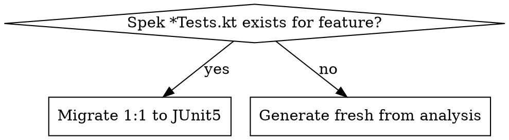

# Generate JUnit5 Tests (Interactor or UseCase)

Generate (or migrate to) a **JUnit5 (Jupiter)** test suite for a component in `customerapp-shared`. The skill **auto-detects the target type from the source path** (Step 0.5) and follows the matching track:

- **Interactor** → exercise the whole interactor cluster (user-action flows, the generated VM, resulting State, inner Listener/Handler classes) through the **real production code path only**. Steps 1–8 below.
- **UseCase** → exercise the use case's public method(s) directly with mocked collaborators, asserting return value + collaborator interactions across every branch. See **Use-Case Track** below.
- **HttpService** → exercise the service's suspend method(s) against a `MockEngine`-backed `HttpClient`, asserting the deserialized response and the outgoing request (path/params/headers). **Build the service through its production `*Factory`/builder — never the raw constructor.** See **HTTP-Service Track** below.

## The Iron Rule

**State is driven through the real production path — NEVER by calling the reducer directly.**

Drive behaviour with `interactor.didBecomeActive()`, then `presenter.tapX()` / `stream.tryEmit(...)` / params. Assert the *result*. The interactor's own code calls the reducer; your test never does.

```kotlin
// ❌ FORBIDDEN — pokes state directly, tests nothing real
reducer.updateUIState(UIState.AddGSTIN)
interactor.currState.uiState shouldBeEqualTo UIState.AddGSTIN

// ✅ REQUIRED — drive the flow, assert the outcome
interactor.didBecomeActive()
presenter.tapConfirm()
interactor.currState.uiState shouldBeInstanceOf UIState.FetchingDetails::class
```

This is non-negotiable. See **Red Flags** below.

## Arguments

- **Source path(s)** (required): one or more absolute paths to Kotlin source files — `*Interactor.kt` and/or use-case files. Multiple paths → grouped by feature, then fanned out (Step 0).

## Step 0: Parse Input and Dispatch

Parse all source paths. A **single path → proceed to Step 0.5** directly.

For **multiple paths, group by feature first, then fan out** — same-feature files share support files (`{Feature}TestBuilder` / `{Feature}TestData` / `Fake{Feature}Presenter`), and parallel agents would otherwise race to create them (the Step 4 "reuse-or-create" rule assumes serial visibility, so two agents can each see a support file as "missing" and create it concurrently → duplicated/clobbered files):

1. **Group paths by feature.** Derive the feature key from the shared `{feature_path}` package/directory — files under the same feature directory (or whose names share the `{Feature}` prefix) belong to one group.
2. **Across groups → parallel.** Dispatch one subagent per *group* simultaneously. Different features touch disjoint support files, so there is no race between groups.
3. **Within a group → serial.** A group with more than one path is handled by a **single** subagent that processes its files one after another (support files are created on the first file and reused by the rest). Never split one feature's files across parallel agents.
4. Each subagent is told its path(s) and instructed to invoke this `generate-junit-tests` skill via the Skill tool (it runs Step 0.5 onward itself, detecting each file's type). Do NOT paste these instructions into the subagent prompt.
5. **Wait for all** to finish, then print a combined summary. **Surface any group/file that failed explicitly** (its path + the error) — a partial run must be visible, never folded silently into the summary.

## Step 0.5: Classify the Target (Interactor vs UseCase vs HttpService) — scenario mapping

Read the file and route by what it **is**, not just its name:



**Interactor signals:** extends `BaseStateVMInteractor<…>`/`BaseInteractor`; constructor takes `presenter`, `reducer`, `vmMapper`, `dispatchers`; overrides `didBecomeActive()`; has inner `*Handler`/`*ListenerImpl` classes; name ends `Interactor`. → run **Steps 1–8**.

**HttpService signals:** an `internal class Http{Feature}Service(...)` that **implements a `{Feature}Service` interface**; constructor takes `HttpClientProvider` (± mappers); public surface is `suspend fun`s whose body is `httpClientProvider.get().get(...)/post(...)` building a request (`url { path(...) }`, `parameter(...)`, headers); lives in a `data/http/` package; **no** Presenter/State/VM/Reducer. → run the **HTTP-Service Track**.

**UseCase signals:** a plain class (often `@Inject constructor`) whose public surface is `operator fun invoke(...)` and/or a few verb-named methods (`current`, `observe`, `incrementShowCount`); constructor deps are repos / other use-cases / analytics / prefs — **no** Presenter/State/VM/Reducer/Router and **no** `HttpClientProvider`; no `didBecomeActive()`. Name is a verb phrase (`Get…`, `Should…`, `Can…`, `Check…`, `Settle…`, `Delete…`) or ends `UseCase`, and/or lives in a `usecases/`/`usecase/` package. → run the **Use-Case Track**.

If genuinely ambiguous (e.g. a coordinator that is neither), say so and ask before generating. Otherwise proceed on the detected track — don't ask when the signals are clear.

## Step 1: Analyze the Interactor

Read the interactor and **all** of these (read their source to learn the real API surface):

- `{Feature}Params`, `{Feature}State`, `{Feature}Reducer` (only to learn state shape + `initState` — never to call it from tests), `{Feature}VMMapper`, `{Feature}VM`
- `{Feature}Presenter` interface (every `didX(): Flow<…>` method), `{Feature}Listener`, `{Feature}Router` (if any)
- `{Feature}Analytics` and its tracking methods
- Every constructor dependency (use-cases, repos, storage, uiUtility…)

Then enumerate, from the interactor body:

- **`didBecomeActive()`** — what runs unconditionally (analytics, init), and which handlers are `launch`ed
- **Every inner `class XxxHandler`** — its trigger (which `presenter.didX()` flow, or params/`didBecomeActive`) and its effects (state, analytics, listener, router, deps)
- **Every inner `class XxxListenerImpl`** (a `*Listener` interface implemented as an inner class) — its callbacks and effects
- **`willResignActive()`** — cleanup behaviour worth asserting

## Step 2: Route — Migrate or Generate (the "Both" rule)



1. Search the feature's test packages for **Spek** specs — files containing `: Spek(` (often `*Tests.kt`). If found → **migrate them 1:1** to JUnit5 (Step 6 mapping), preserving every scenario. **Leave the original Spek file untouched** (per MOB-11643: Spek files are removed only after the JUnit equivalent is verified green).
2. If no Spek exists → **generate fresh** from the Step 1 analysis. If **Cucumber** tests already exist for the feature (`*StepDefs.kt` + `.feature`), read them and mine each `Scenario` as a coverage checklist so the JUnit5 suite preserves existing behaviour.

## Step 3: Determine File Paths

**JUnit5 tests mirror the PRODUCTION package directly — NOT under the `tests/` segment** Cucumber uses.

Source:

```text
shared/src/commonMain/kotlin/in/porter/customerapp/shared/{feature_path}/{Feature}Interactor.kt
```

Tests:

```text
shared/src/test/kotlin/in/porter/customerapp/shared/{feature_path}/
```

(Confirm by reading an existing JUnit5 test in a sibling/nearby package — match the exact convention.)

**One test file per inner class:**

| File | Contents |
|---|---|
| `{Feature}InteractorTest.kt` | `didBecomeActive` unconditional effects, params/stream-driven init, VM-mapping scenarios (conditional/derived fields only — see Step 5), `willResignActive` cleanup |
| `{HandlerName}Test.kt` | one per inner `*Handler` class (e.g. `ConfirmButtonHandlerTest.kt`) |
| `{ListenerName}ImplTest.kt` | one per inner `*ListenerImpl` class |

**Reuse-or-create support files** (shared by all the above — see Step 4):
`{Feature}TestBuilder.kt`, `{Feature}TestData.kt`, `Fake{Feature}Presenter.kt`.

## Step 4: Reuse-or-Create Support Files

**Search first; reuse if present; only create what's missing. Never duplicate.**

- **`Fake{Feature}Presenter`** — implements the Presenter interface with a `MutableSharedFlow` per action, a public `tapX()`/`changeX(v)` emitter per action, and `render { lastRenderedVM = it }`. (Note: VM is asserted via `interactor.vmStream.value`; `lastRenderedVM` is optional.) Never mock a presenter.

  ```kotlin
  class Fake{Feature}Presenter : {Feature}Presenter {
    private val confirmTaps = MutableSharedFlow<Unit>(replay = 1)
    private val gstinChanges = MutableSharedFlow<String>(replay = 1)
    fun tapConfirm() { confirmTaps.tryEmit(Unit) }
    fun changeGstin(v: String) { gstinChanges.tryEmit(v) }
    override fun didTapConfirm(): Flow<Unit> = confirmTaps
    override fun didChangeGSTIN(): Flow<String> = gstinChanges
    override fun render(vm: {Feature}VM) { /* no-op or capture */ }
  }
  ```

- **`{Feature}TestBuilder`** — `object` with `build{Feature}Interactor(...)` and `build{Feature}Params(...)`. Every dependency is a defaulted parameter: presenter = the Fake, analytics = `spyk(...)`, listener/router/repos/use-cases = `mockk(relaxed = true)`, reducer/vmMapper = real instances, dispatcher = `UnconfinedTestDispatcher()`. Wire `StateVMInteractorDispatchers(d, d, d)`, the coroutine exception handler (via the repo's existing `CoroutineExceptionHandlerTestFactory`/`FakeCoroutineExceptionHandlerProvider`), and `.also { it.router = router }` if the interactor has a router.
- **`{Feature}TestData`** — `object` with `buildX()` factories for params/state/domain inputs, all fields defaulted.

## Step 5: Write the Test Files

**Reference pattern:** existing repo JUnit5 tests (e.g. `BillInfoInteractorTest.kt`). Mirror it.

Skeleton (per test file):

```kotlin
@file:Suppress("EXPERIMENTAL_API_USAGE")

package `in`.porter.customerapp.shared.{feature_path}

import io.mockk.coVerify
import io.mockk.mockk
import io.mockk.spyk
import io.mockk.verify
import kotlinx.coroutines.Dispatchers
import kotlinx.coroutines.ExperimentalCoroutinesApi
import kotlinx.coroutines.flow.MutableSharedFlow
import kotlinx.coroutines.test.UnconfinedTestDispatcher
import kotlinx.coroutines.test.resetMain
import kotlinx.coroutines.test.setMain
import org.amshove.kluent.shouldBeEqualTo
import org.amshove.kluent.shouldBeInstanceOf
import org.junit.jupiter.api.AfterEach
import org.junit.jupiter.api.BeforeEach
import org.junit.jupiter.api.Nested
import org.junit.jupiter.api.Test

@OptIn(ExperimentalCoroutinesApi::class)
class ConfirmButtonHandlerTest {

  private val testDispatcher = UnconfinedTestDispatcher()
  private val presenter = Fake{Feature}Presenter()
  private val analytics = spyk({Feature}Analytics(mockk(relaxed = true)))
  private val listener = mockk<{Feature}Listener>(relaxed = true)

  @BeforeEach
  fun setup() { Dispatchers.setMain(testDispatcher) }

  @AfterEach
  fun tearDown() { Dispatchers.resetMain() }

  private fun buildInteractor(/* scenario params */) =
    {Feature}TestBuilder.build{Feature}Interactor(
      dispatcher = testDispatcher,
      presenter = presenter,
      analytics = analytics,
      listener = listener,
    )

  @Nested
  inner class WhenConfirmTappedWithInvalidGstin {
    private val interactor = buildInteractor()

    @BeforeEach
    fun arrange() {
      interactor.didBecomeActive()
      presenter.changeGstin("bad")
      presenter.tapConfirm()
    }

    @Test
    fun `surfaces a validation error in state`() {
      interactor.currState.validationError shouldBeEqualTo ValidationError.InvalidFormat
    }

    @Test
    fun `logs the validation error`() {
      verify { analytics.logValidationError(any(), any()) }
    }
  }
}
```

**Assertion accessors (use exactly these):**

| Target | Accessor |
|---|---|
| State | `interactor.currState.<field>` |
| **Generated VM** | **`interactor.vmStream.value`** (cast to subtype: `interactor.vmStream.value as LoadedVM`) |
| Analytics / non-suspend listener | `verify { ... }` |
| Router / suspend listener calls | `coVerify { ... }` (`coVerify(exactly = 0)` for "did not happen") |
| Inner listener callback | `interactor.{ListenerName}Impl().onX()` |

**Structure rules:**
- One `@Nested inner class WhenX` per scenario; `@BeforeEach` arranges (activate + drive flow), `@Test` asserts. Multiple `@Test`s per scenario = one assertion each, descriptive backtick names.
- Always `interactor.didBecomeActive()` before driving interactions.
- For init/`didBecomeActive` behaviour that depends on params, build the interactor with the relevant `build{Feature}Params(...)` variant, then `didBecomeActive()`.
- `Dispatchers.setMain(UnconfinedTestDispatcher())` in `@BeforeEach`, `resetMain()` in `@AfterEach`. Use `mockkObject`/`unmockkObject` (with `@AfterEach unmockkObject`) for object dependencies like `CountryRepo`.

**Branch & attribute coverage (exhaustive) — every scenario, not just the happy path:**

A handler/flow is only "covered" when each input that changes its behaviour is exercised in *both* directions and the *recorded effect* — not just the method call — is asserted. Enumerate the matrix before writing: for a flow reading one `Boolean` and one nullable, cover the `{true, false} × {null, present}` combinations that change observable output (collapse only combinations that are genuinely independent).

- **VM / VMMapper is covered *through the interactor*, never standalone.** There is no separate VMMapper test. A VM field is validated only as a byproduct of an interactor-driven scenario: drive the interactor (`didBecomeActive()` + `presenter.tapX()` / `stream.tryEmit(...)` / the relevant `build{Feature}Params(...)`) into the **state + params** that trigger a given mapping branch, then assert `interactor.vmStream.value`. Never construct the VMMapper or a State object yourself to check a field — that violates the Iron Rule and tests the mapper in a vacuum instead of the real production path.
- **VM fields → assert only conditional/derived mappings, NOT passthroughs.** Within those interactor-driven scenarios, a VM field earns a dedicated `@Test` only when its mapping involves a *decision*: a branch (`if`/`when`), a transformation or formatting (`"₹$amount"`, a date/number format, a `StringRes` resolution — asserted per Step 7 §7), a null/fallback (`x ?: y`, `a?.b?.c`), or a value **derived from more than one** state/param field. A field that is a straight unconditional copy of a single primitive state/param value — `vm.title = state.title`, `vm.count = state.count` (plain `String`/`Int`/`Boolean`, no logic) — does **NOT** get its own `@Test`: asserting it merely restates the copy and inflates the suite without catching any interactor-level bug. Such fields still ride along in whatever scenario builds the VM (so they're exercised), but write **no assertion dedicated to them**. Before adding a VM assertion, look at the VMMapper line for that field: no branch/transform/fallback/derivation → skip it. Which conditional fields are reachable is itself dictated by the interactor's logic — only cover the state/param combinations the interactor can actually produce.
- **Booleans → both branches.** For every `Boolean` input the flow reads (a use-case result like `canUseGoodsV2Rib()`, a param flag, a stream value), write one scenario for `true` and one for `false`. Stub it explicitly each time (`every { canUseGoodsV2Rib() } returns false` / `… returns true`) — never let a relaxed mock's default stand in for the "false" case. Make each a named `@Nested` so the branch is visible, and assert the effect differs (different attribute value / different state / call vs no-call).
- **Nullables → null and non-null.** For every nullable input (`ptlExperimentVariant: String?`, optional params, nullable stream payloads), cover the `null` case *and* a present value, asserting the produced result for each (e.g. VM field becomes `null` vs the mapped value).
- **Chained optional calls → each branch.** When the flow/VMMapper does `params.outStation?.title`, `repo.x?.y?.z`, or `?:` fallbacks, test each link: the present path (value flows through) and the absent path (stays `null` / uses the fallback). One `@Test` per branch.
- **Verify the analytics call with its arguments — don't drill into the event payload.** The `analytics` instance is a `spyk` over the real analytics class, so `verify { analytics.logXClickV2(true, "variant_a") }` is sufficient: it proves the interactor invoked the right method with the right flag + variant for each branch. Do NOT expose `eventPublisher`/`eventRecorder` to assert the recorded event name + attribute map — that just re-states the analytics class's own implementation and adds brittleness without catching interactor-level bugs. Cover one scenario per branch (true/false, null/present) and assert the call (or, for the negative case, `verify(exactly = 0)` / a differing argument).

## Step 6: Spek → JUnit5 Mapping (migration mode)

| Spek | JUnit5 |
|---|---|
| `object XxxTests : Spek({ ... })` | `class XxxTest { ... }` |
| `describe("…") { }` | `@Nested inner class WhenXxx { }` |
| `beforeEach { }` / `afterEach { }` | `@BeforeEach fun setup()` / `@AfterEach fun tearDown()` |
| `it("does x") { }` | `@Test fun \`does x\`() { }` |
| `val foo by memoized { … }` | field init (or per-`@Nested` field/`@BeforeEach`) |
| `shouldEqual` / `shouldBe` | `shouldBeEqualTo` / `shouldBeInstanceOf` (kluent stays) |
| nested `describe` | nested `@Nested inner class` |

Preserve every `it` as a `@Test`. Keep using the feature's existing `TestBuilder`/`TestData`/`FakePresenter`. Split per the file-per-inner-class rule even if the Spek file was monolithic.

## Step 7: Code Style

1. Package = backtick `` `in`.porter.customerapp.shared.{feature_path} `` (mirrors production, no `tests` segment).
2. **No `runTest { }`** — it never completes on CI; rely on `UnconfinedTestDispatcher` + `setMain`. Use `runBlocking` only if a suspend call must be invoked directly.
3. **kluent** assertions (`shouldBeEqualTo`, `shouldBeInstanceOf`, `shouldBe`). Don't switch libraries.
4. Indent 2 spaces; trailing commas allowed; max line 120; one blank line at EOF.
5. Underscores in numeric literals (`500_000.0`); no wildcard imports; remove unused imports.
6. Test names: backticked sentences describing behaviour, not method names.
7. **Assert localized strings by resolving the same `StringRes`, not by hardcoding the text.** `VMMapper` builds strings via `SomeStrings.foo.str()`, which resolves through the global `VMMapperV2.stringProvider` (an atomic `StringProvider`, default `English`). `BaseStateVMInteractor` sets that provider from the locale (`FakeAppLanguageRepo` → `English`) on `didBecomeActive()`. So after the interactor is active, assert the VM field against the **same `StringRes` resolved the same way** — `vm.titleTxt shouldBeEqualTo SomeStrings.foo.str(VMMapperV2.stringProvider)` (import `in.porter.kmputils.commons.localization.str` + `in.porter.kmputils.flux.base.VMMapperV2`). This verifies the VMMapper wired the **correct string key** without restating the literal English text, so a copy edit to the resource won't break the test, but mapping the wrong key will. **Exception:** when the flow/VMMapper branches on `CountryRepo`/`Country` (e.g. India vs other countries), `mockkObject(CountryRepo)` + `every { CountryRepo.country } returns Country.India`, and assert the country-specific `StringRes` (or its resolved value) per branch.

## Step 8: Verify

Per the project rule, **do not run gradle unprompted — ask the user first**, then:

```bash
./gradlew :shared:testDebugUnitTest --tests "*{Feature}*Test"
```

Fix compile/assertion errors and re-run until green. Only after the JUnit suite is green should any superseded Spek file be removed (and only if the user asks).

---

# Use-Case Track

Run this instead of Steps 1–8 when Step 0.5 classified the target as a **UseCase**. A use case is plain business logic with no Flux cluster, so the test is far simpler: construct it directly, call its method, assert the result + collaborator calls. **No `TestBuilder`/`TestData`/`FakePresenter`, no dispatchers/`setMain`, no `didBecomeActive()`, no VM/State.**

## U1: Analyze the UseCase

Read the source and enumerate:
- **Public method(s)** — `operator fun invoke(...)`, and any other public methods (`current`, `observe`, `incrementShowCount`, …). Each is its own group of scenarios.
- **Return type** — `Boolean` / value / nullable / `Flow<T>` / `Unit` (effect-only). Decides what you assert.
- **Constructor collaborators** — repos, other use-cases, analytics, prefs, crashlytics. All become `mockk(relaxed = true)`.
- **Every branch inside the method** — `if`/`when` (especially over sealed types), boolean conditions, `?:`/`?.` chains, boundary comparisons (`<`, `>=`), `try`/`runSafely…` fallbacks, early returns.

## U2: Determine File Path

Mirror the production package exactly (no `tests/` segment), filename `{UseCaseName}Test.kt`. E.g. `…/review/checkout/holdinfo/usecase/ShouldAutoShowHoldInfoUseCaseTest.kt`.

## U3: Migrate or Generate

Same "Both" rule as Step 2: if a **Spek** spec exists for the use case, migrate 1:1 (Step 6 mapping) and leave the Spek file untouched; else generate fresh from U1. Mine any existing Cucumber `*StepDefs.kt` scenarios as a coverage checklist.

## U4: Structure & Conventions

```kotlin
class ShouldAutoShowHoldInfoUseCaseTest {

  private val getPaymentConfig: GetPaymentConfig = mockk(relaxed = true)
  private val rootPrefs: RootPrefs = mockk(relaxed = true)

  // Construct directly — per-test if state matters, or a shared field if stateless.
  private val useCase = ShouldAutoShowHoldInfoUseCase(getPaymentConfig, rootPrefs)

  @Test
  fun `invoke returns false when payment mode is Cash`() = runBlocking {
    // When — Cash short-circuits before any config lookup
    val result = useCase.invoke(PaymentMode.Cash, configVersion = 1)
    // Then
    result.shouldBeFalse()
    coVerify(exactly = 0) { getPaymentConfig.getConfig(any()) }
  }
}
```

- **`runBlocking { }` per `@Test`** for suspend methods — this is allowed here (a use case completes; it has no hot foreground flows to park on, unlike an interactor). For `Flow`-returning methods collect with `.first()` / `toList()` inside `runBlocking`.
- **Construct the use case directly** with mocked collaborators. Shared field is fine when stateless; construct per-test (or use `returnsMany`) when a method mutates state across calls.
- **AAA comments** (`// Given / When / Then`) per the repo's testing convention.
- **`mockk` nested stubbing** for config objects: `mockk { every { x.y } returns z }`. Use `coEvery`/`coVerify` for suspend collaborators, `every`/`verify` otherwise.
- **Assertions:** prefer kluent for consistency (`shouldBeEqualTo`, `shouldBeTrue`, `shouldBeFalse`, `shouldBeNull`); if migrating a file that already uses `org.junit.jupiter.api.Assertions`/`kotlin.test`, match it — don't mix styles within a file.
- **File-per-class:** one `{UseCase}Test.kt` per use case. When a use case has several public methods, group with `@Nested inner class WhenInvoked` / `WhenIncrementing…` rather than splitting files.

## U5: Coverage — the same exhaustive matrix

Apply **Branch & attribute coverage** (above) to the use case's logic:
- **Booleans → both branches**, stubbed explicitly. Assert the differing result for each.
- **Sealed-type / `when` inputs → one scenario per variant** (e.g. `Card`, `ApplePay`, `Cash`, `BusinessAccount`), asserting eligible vs not.
- **Boundaries** — for numeric comparisons cover `<`, `==`, `>` the threshold, plus edge configs (max = 0, 1).
- **Nullables → null and present**; chained optionals → each branch.
- **Fallback / exception paths** — when the use case wraps a call in `try`/`runSafely…`, stub the collaborator to `throws` and assert the default path.
- **Negative interactions** — when a branch should NOT call a collaborator, assert `coVerify(exactly = 0) { … }`.
- **Argument payloads** — when the use case forwards structured args to a collaborator (analytics/crashlytics), assert them with `verify { dep.track(a = …, b = …) }` or `match { … }`.
- **Stateful sequences** — use `returnsMany listOf(...)` to model read-then-write-then-read across successive calls.

## U6: Verify

Same as Step 8 — **ask before running gradle**, then `./gradlew :shared:testDebugUnitTest --tests "*{UseCaseName}Test"`, fix, re-run until green.

The **Code Style** and **Red Flags** sections below apply to all tracks (skip the interactor-only items — reducer/Presenter/VM/`didBecomeActive` — for use cases and http services).

---

# HTTP-Service Track

Run this instead of Steps 1–8 / the Use-Case Track when Step 0.5 classified the target as an **HttpService**. An HTTP service is a thin adapter: it builds a request, fires it through a Ktor `HttpClient`, and deserializes the response. So the test drives the **real** service against a **`MockEngine`-backed `HttpClient`** and asserts (a) the deserialized response and (b) the outgoing request shape. **No Flux cluster, no dispatchers/`setMain`, no VM/State, no reducer.**

## H1: Analyze the Service

Read the source and enumerate:
- **The `{Feature}Service` interface** it implements — every `suspend fun` and its signature (params + return type).
- **Each method body** — HTTP verb (`get`/`post`/…), the `url { path(...) }` segments, every `parameter(...)` (note which come from nullable args), headers (`addGatewayHostTypeHeader()`, auth), and the request body for writes.
- **Response + error types** — the `*Response` serializer returned and the `*ApiException`/error serializer, so success and failure can both be exercised.
- **Constructor deps** — `HttpClientProvider` (always) plus any request/response mappers.

## H2: Find the production builder (MANDATORY)

The service is `internal` and is **never constructed directly in production** — it is created through a factory/builder object. **Find it and build through it in the test.**

```bash
grep -rn "Http{Feature}Service(" shared/src/commonMain   # locate the construction site
```

You'll typically find an `object {Feature}ServiceFactory { fun build(httpClientProvider): {Feature}Service = Http{Feature}Service(...) }` (e.g. `AppConfigServiceFactory.build(httpClientProvider)`). The test **must** call that factory, not `Http{Feature}Service(...)`. If no factory exists, look for the repo/factory that news it up (`*RepoFactory`) and go through that; only fall back to the constructor if there is genuinely no builder, and note that in your summary.

The `buildService()` helper therefore returns the **interface type** (`{Feature}Service`) the factory returns — the tests only need the public interface.

## H3: Determine File Path

**Unlike the interactor/use-case tracks, co-locate the HttpService test with its existing Cucumber support files** — under the `tests/` segment, in the same `tests/.../data/http/` package — so the existing `{Feature}ServiceTestData` object is reusable **in-package** (no import, and it stays the single source of the response fixtures):

```text
shared/src/test/kotlin/in/porter/customerapp/shared/tests/{feature_path}/data/http/Http{Feature}ServiceTest.kt
```

e.g. `…/tests/root/appconfig/data/http/HttpAppConfigServiceTest.kt`, sitting beside `HttpAppConfigServiceStepDefs.kt` / `HttpAppConfigServiceTestHelper.kt` / `HttpAppConfigServiceTestData.kt`. If no Cucumber `*TestData` exists for the service, either mirror the production package or place it here and add the fixtures — but prefer reuse.

## H4: Migrate or Generate

Same "Both" rule as Step 2 / U3: if a **Spek** spec exists, migrate 1:1 and leave the Spek file untouched. Otherwise generate fresh from H1, and **mine any existing Cucumber `*StepDefs.kt` + `.feature` scenarios as a coverage checklist** — the AppConfig service, for instance, has scenarios for "both args present", "geoRegionId null", "deviceId null". Reuse the existing `*TestData` fixtures rather than rebuilding response JSON.

## H5: Structure & Conventions

The core pattern: mock `HttpClientProvider`, back it with a `MockEngine` that returns a canned response (and optionally captures the request), build via the factory, call the suspend method inside `runBlocking`.

```kotlin
package `in`.porter.customerapp.shared.tests.root.appconfig.data.http

import `in`.porter.customerapp.shared.root.appconfig.data.AppConfigService
import `in`.porter.customerapp.shared.root.appconfig.usecases.AppConfigServiceFactory
import `in`.porter.kmputils.commons.platform.HttpClientProvider
import io.ktor.client.HttpClient
import io.ktor.client.engine.mock.MockEngine
import io.ktor.client.engine.mock.respond
import io.ktor.client.request.HttpRequestData
import io.ktor.http.ContentType
import io.ktor.http.HttpHeaders
import io.ktor.http.HttpStatusCode
import io.ktor.http.headersOf
import io.mockk.coEvery
import io.mockk.mockk
import kotlinx.coroutines.runBlocking
import org.junit.jupiter.api.Test
import kotlin.test.assertEquals

class HttpAppConfigServiceTest {

  private val httpClientProvider: HttpClientProvider = mockk(relaxed = true)

  // Builds the service the way production does — via the factory — with a MockEngine-backed
  // HttpClient injected through the mocked provider. `onRequest` optionally captures the request.
  private fun buildService(
    statusCode: HttpStatusCode = HttpStatusCode.OK,
    response: String = HttpAppConfigServiceTestData.successResponse,
    onRequest: ((HttpRequestData) -> Unit)? = null,
  ): AppConfigService {
    val engine = MockEngine { request ->
      onRequest?.invoke(request)
      respond(
        content = response.encodeToByteArray(),
        status = statusCode,
        headers = headersOf(HttpHeaders.ContentType, ContentType.Application.Json.toString()),
      )
    }
    val client = HttpClient(engine)
    coEvery { httpClientProvider.get() } returns client
    return AppConfigServiceFactory.build(httpClientProvider)
  }

  @Test
  fun `fetchAppConfig returns valid response with geoRegionId and deviceId`() = runBlocking {
    val service = buildService()

    val result = service.fetchAppConfig(
      HttpAppConfigServiceTestData.testGeoRegionId,
      HttpAppConfigServiceTestData.testDeviceId,
    )

    assertEquals(HttpAppConfigServiceTestData.testCustomerCareNumber, result.appConfig.customerCareNumber)
  }

  @Test
  fun `fetchAppConfig hits fetch_app_config path with geo_region_id and device_id params`() = runBlocking {
    lateinit var captured: HttpRequestData
    val service = buildService(onRequest = { captured = it })

    service.fetchAppConfig(
      HttpAppConfigServiceTestData.testGeoRegionId,
      HttpAppConfigServiceTestData.testDeviceId,
    )

    assertEquals("/customers/fetch_app_config", captured.url.encodedPath)
    assertEquals(HttpAppConfigServiceTestData.testGeoRegionId.toString(), captured.url.parameters["geo_region_id"])
    assertEquals(HttpAppConfigServiceTestData.testDeviceId, captured.url.parameters["device_id"])
  }
}
```

- **`runBlocking { }` per `@Test`** — allowed here (the call completes; no hot foreground flow to park on). Do **not** use `runTest`.
- **Build ONLY via the factory** found in H2 (`buildService()` returns the interface type).
- **`MockEngine` is the seam** — never mock the `HttpClient`/response deserialization. Mock only `HttpClientProvider.get()` (via `coEvery { httpClientProvider.get() } returns client`) to hand back the real client wired to the engine.
- **Assertions:** `kotlin.test.assertEquals` matches the existing service tests; kluent is fine too — match whatever a sibling test in that package already uses. Don't mix styles within a file.

## H6: Coverage — request + response, both outcomes

Enumerate before writing:
- **Response deserialization** — assert a representative field off the parsed model (proves the serializer + JSON wiring), one happy-path `@Test`.
- **Request shape** — capture the `HttpRequestData` via `onRequest` and assert `url.encodedPath`, each `url.parameters[...]`, and any required header (`captured.headers[...]`). This proves path/params/headers the method builds.
- **Nullable args → both directions.** For every nullable method arg that becomes a `parameter(...)` (e.g. `geoRegionId: Int?`, `deviceId: String?`), cover the present case *and* the `null` case. Mirror the Cucumber scenarios: with a relaxed setup the null arg simply omits/blanks the query param — assert the response still deserializes (as the existing scenarios do) and, where it matters, that the param is absent (`captured.url.parameters["geo_region_id"] == null`).
- **Non-2xx / error body → failure path.** Build with `statusCode = HttpStatusCode.BadRequest` (or the relevant code) and an error-JSON body, then assert the method throws the expected `*ApiException` — `assertFailsWith<SimpleApiException> { runBlocking { service.fetchAppConfig(...) } }`. Skip only if the service has no error deserializer wired.
- **POST/body writes** — when the method sends a body, assert the outgoing body (`(captured.body as TextContent).text`, or decode it) matches the serialized request payload.

## H7: Verify

Same as Step 8 — **ask before running gradle**, then `./gradlew :shared:testDebugUnitTest --tests "*Http{Feature}ServiceTest"`, fix, re-run until green.

---

## Red Flags — STOP

- Calling `reducer.updateX()` / `reducer.setX()` from a test
- Asserting state you set yourself instead of state the flow produced
- Mocking the Presenter instead of using a `Fake*Presenter`
- Reading the VM via anything other than `interactor.vmStream.value`
- Putting **interactor/use-case** tests under a `tests/` package segment (that's Cucumber) — HttpService tests are the deliberate exception (H3: co-located to reuse the Cucumber `*TestData`)
- Using `runTest { }`
- One giant test file instead of one-per-inner-class
- Duplicating an existing `TestBuilder`/`TestData`/`FakePresenter`
- Writing a dedicated `@Test` for an unconditional passthrough VM field (a plain `String`/`Int`/`Boolean` copied straight from state/params with no branch, transform, fallback, or derivation) — assert only conditional/derived VM fields
- Testing only one branch of a `Boolean`/nullable input — relying on a relaxed-mock default for the other branch
- Exposing `eventPublisher`/`eventRecorder` to assert the recorded event name + attribute map — the `spyk` analytics call + its args is enough; payload assertions just re-state the analytics impl
- Skipping the null / fallback branch of a chained optional (`a?.b?.c`, `x ?: y`)
- Hardcoding a localized string literal (`shouldBeEqualTo "Choose your service"`) instead of resolving the same `StringRes` via `SomeStrings.foo.str(VMMapperV2.stringProvider)`
- **(HttpService)** Constructing `Http{Feature}Service(...)` directly instead of through its production `{Feature}ServiceFactory.build(...)`/repo factory
- **(HttpService)** Mocking the `HttpClient` or the service's own suspend method instead of using a `MockEngine` as the seam
- **(HttpService)** Asserting only the response and never the outgoing request (path/params/headers), or skipping the `null`-arg and non-2xx error branches

Any of these → stop and fix before continuing.

## Example

```text
/generate-junit-tests /…/shared/…/loggedin/gstindetail/GSTINDetailInteractor.kt
```

Produces (reusing any existing support files):
- `GSTINDetailInteractorTest.kt` (init via params + `didBecomeActive`, VM mapping, `willResignActive`)
- `GSTINInputHandlerTest.kt`, `ConfirmButtonHandlerTest.kt`, `CloseButtonHandlerTest.kt`, … (one per inner Handler)
- `GSTINDetailTestBuilder.kt` / `GSTINDetailTestData.kt` / `FakeGSTINDetailPresenter.kt` (only if not already present)

HttpService example:

```text
/generate-junit-tests /…/shared/…/root/appconfig/data/http/HttpAppConfigService.kt
```

Produces a single `HttpAppConfigServiceTest.kt` beside the existing Cucumber files (`…/tests/root/appconfig/data/http/`), built via `AppConfigServiceFactory.build(...)`, reusing `HttpAppConfigServiceTestData`, covering: response deserialization, request path/params, each nullable arg (`geoRegionId`/`deviceId`) present + null, and the non-2xx error path.
